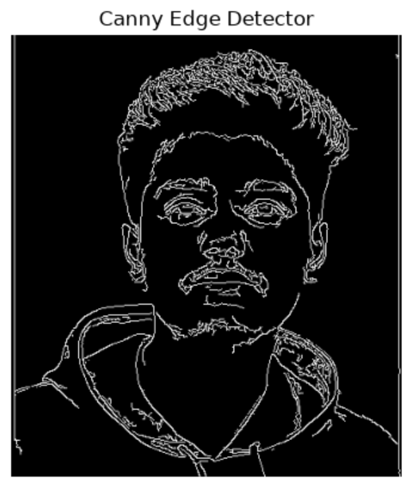

#  Record-HOUGH TRANSFORM
## Developed By

* **Name:** Junjar U
* **Register No:** 212224230110

##  Aim

To implement a basic lane detection pipeline using OpenCV by completing missing code segments at specified locations.

---

## Learning Objective

* Understand each stage of image processing
* Learn how to build a complete computer vision pipeline
* Practice writing code in guided sections


---

##  Software Used

* Anaconda – Python 3.7
* Jupyter Notebook / VS Code
* OpenCV (cv2)
* NumPy
* Matplotlib

---

##  Algorithm & Explanation

---

###  Step 1: Import Libraries

```
import cv2
import numpy as np
import matplotlib.pyplot as plt
```

---

###  Step 2: Convert the image to grayscale

```
gray_image = cv2.cvtColor(image, cv2.COLOR_BGR2GRAY)
```

### Step 3: Input image and grayscale image
```
plt.imshow(cv2.cvtColor(image, cv2.COLOR_BGR2RGB)) 

```

###  Step 4: Display Images

```
plt.title("Input Image")
plt.axis('off')
plt.imshow(gray_image, cmap='gray')
plt.title("Grayscale Image")
plt.axis('off')

```

###  Step 5: Using Canny operator from cv2, detect the edges of the image

```
edges = cv2.Canny(gray_image, 50, 150)

```

###  Step 6: Canny Edge Detector output
```
plt.imshow(edges, cmap='gray')
plt.title("Canny Edge Detector")
plt.axis('off')

```

### Step 7: Using the HoughLinesP(), detect line coordinates for every point in the image

```
lines = cv2.HoughLinesP(edges, 1, np.pi / 180, 100, minLineLength=50, maxLineGap=10)

```

###  Step 8: Using a for loop, draw the lines on the original image using the detected coordinates

```

for line in lines:
    x1, y1, x2, y2 = line[0]  # Unpacking the line coordinates
    cv2.line(image, (x1, y1), (x2, y2), (0, 255, 0), 2)

```

###  Step 9: Display the result of Hough Transform (Image with lines)
```

plt.imshow(cv2.cvtColor(image, cv2.COLOR_BGR2RGB))  # Image with lines drawn
plt.title("Result of Hough Transform")
plt.axis('off')

```

##  Expected Output

* Original image


* Grayscale image


* Canny Edge Detector



* Result of Hough Transform


---

## Result

Thus, the lane detection pipeline is successfully implemented by completing the missing code sections. The system detects and highlights lane lines effectively.

---


